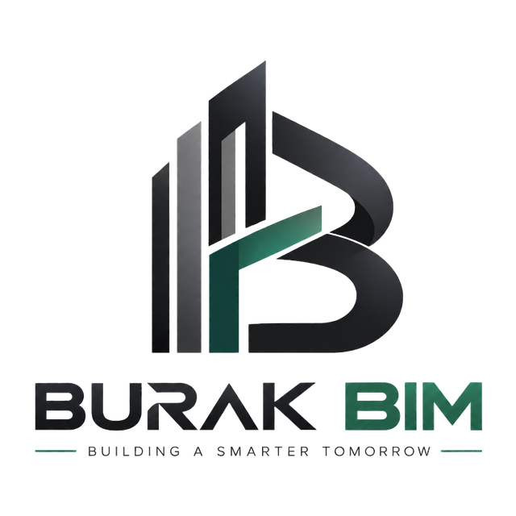

<p align="center"></p>

<h1 align="center">BURAK BIM</h1>
<p align="center"><b>One MCP connector for BIM, CAD, structural and takeoff software.</b><br>
Revit · AutoCAD · Civil 3D · Plant 3D · Map 3D · Advance Steel · Navisworks (2022 – 2027) · SAP2000 · ETABS · CSiBridge · SAFE · Archicad · Bluebeam Revu · PlanSwift · Inventor · ReCap Pro · Robot · Rhino<br>
Claude Desktop · Claude Code · ChatGPT Codex · Google Antigravity · Cursor · Windsurf · Gemini · VS Code · Visual Studio · Cline · Roo · LM Studio · any MCP client</p>

---

Most MCP connectors for AEC software ship as **one server per product**, each with a **fixed list of hand-written tools**. If a command isn't in the list, the AI can't run it, and the AI can't see what it did.

BURAK BIM takes a different approach. One installer and one MCP server detect the software on the PC and ship **about 1,100 tools**. The AI agent gets **seven layers of control** and **eyes on the model**:

| # | Layer | Reach | Products |
|---|---|---|---|
| 1 | **Purpose-built tools** (`revit_create`, `navisworks_clash_run`, `csi_results`, `bluebeam_takeoff_summary`, `planswift_quantities`, `scan_to_bim`, …) | Fast, safe, documented | Revit, AutoCAD/Civil 3D, Navisworks, SAP2000/ETABS/CSiBridge/SAFE, Bluebeam, PlanSwift, Archicad, Robot, Inventor, Rhino, Dynamo |
| 2 | **Every ribbon button** (`ribbon_list`, `ribbon_invoke`) | Every tab, panel and button, including contextual and **third-party add-in tabs** | Revit, AutoCAD + verticals, Navisworks |
| 3 | **Every native command** (`revit_command`, `autocad_command`, `inventor_command`) | All Revit PostableCommands, AutoCAD/Civil 3D command line and macros, Inventor ControlDefinitions | Revit, AutoCAD family, Inventor |
| 4 | **The whole API** (`api_*`, `csi_call`, `com_*`, `planswift_call`) | Any .NET class/method by reflection; every CSI OAPI function with by-ref outputs handled; any COM object | Revit, AutoCAD, Civil 3D, Navisworks, CSI, PlanSwift, Inventor, Robot … |
| 5 | **Live C# scripting** (`script_run`) | Anything the API can do, in one undo step | Revit, AutoCAD, Civil 3D, Navisworks |
| 6 | **Windows UI Automation** (`ui_*`) | Any dialog, button, tree or grid | Anything with a window |
| 7 | **Computer control, with your permission** (`computer_*`) | Mouse and keyboard, used only after you click **Yes** on screen; Ctrl+Alt+Q stops it | Everything, including apps without an API |

**Capture mode** makes the AI *see*. `revit_capture` renders any plan, section, elevation, 3D view or sheet through the Revit API. `capture` shows any application window or dialog. When capture mode is on (the default), every change comes back with a picture of the result.

**BIM workflow skills** give the AI the *method* as well as the tools: 28 step-by-step professional workflows, including BIM management and VDC (project setup, QA gate, 4D, 5D, drawing review, handover). They cover model health, documentation, ISO 19650 document control, architecture / structure / MEP modelling, scan-to-BIM, clash coordination, ETABS/SAP2000 analysis, Bluebeam/PlanSwift takeoff, AutoCAD cut files, Civil 3D site and Archicad. They work in every AI app through `burak_skills`, MCP prompts and resources. Add your own company skills as `SKILL.md` files.

On top of these layers come **Scan-to-BIM** and a **BIM-Inspector workflow**. Every element an AI creates is stamped with the AI client, session, tool, user and time. It is color-coded for review, checked against the point cloud and logged in an audit trail.

### What's new in 1.3

- **Works in every version on every PC.** The installer ships prebuilt bridges for Revit, AutoCAD and Navisworks 2022–2027 and a self-contained server. Nothing is downloaded or compiled at setup, so company firewalls and missing .NET installs no longer break it.
- **Connects to every AI app.** It auto-connects to 19 AI clients, offers a one-click Claude Desktop extension (`BURAK-BIM.mcpb`), and adapts the tool list to each client's limits.
- **New connectors and tools.** Capture mode, computer control with your permission, and connectors for SAP2000, ETABS, CSiBridge, SAFE, Bluebeam Revu and PlanSwift. See the [CHANGELOG](CHANGELOG.md).

## Contents
- [Install](#install)
- [What gets detected and connected](#what-gets-detected-and-connected)
- [Use it](#use-it)
- [Scan-to-BIM](#scan-to-bim)
- [BIM Inspector workflow](#bim-inspector-workflow)
- [Safety and governance](#safety-and-governance)
- [Tools](#tools)
- [Configuration](#configuration)
- [Folder layout](#folder-layout)
- [Uninstall](#uninstall)
- [Build from source](#build-from-source)
- [FAQ and honest limits](#faq-and-honest-limits)

## Install

**Requirements:**

- Windows 10/11 x64.
- Any of the supported programs installed.
- No internet, no .NET and no admin rights are needed. Setup uses no PowerShell, no scheduled tasks and no self-extracting files.
- **macOS:** Revit, Navisworks, Civil 3D, SAP2000, ETABS, Bluebeam and PlanSwift are Windows programs, so BURAK BIM runs on the Windows PC where they are installed. On a Mac, run them in Parallels or another Windows VM and install BURAK BIM inside Windows. Archicad for Mac can be reached through its JSON API from a Windows PC on the same machine or network.

1. Download `BURAK-BIM-Installer-<version>-win-x64.zip` from Releases and extract it. It contains the installer and the uninstaller.
2. **Close Revit, AutoCAD, Navisworks and your AI apps.**
3. Run **`BURAK-BIM-Installer.exe`**. Keep the default folder `D:\BURAK BIM` or pick another drive.
4. Restart your AI app. To fully quit Claude Desktop, right-click the tray icon and choose Quit. Claude Desktop users can also double-click **`BURAK-BIM.mcpb`** (one-click extension).
5. Open your software and ask your AI: *"Use BURAK BIM: burak_status"*.

You can also run the PowerShell installer from the extracted ZIP, without the .exe:

```powershell
powershell -ExecutionPolicy Bypass -File installer\install.ps1                      # D:\BURAK BIM, all detected AI clients
powershell -ExecutionPolicy Bypass -File installer\install.ps1 -InstallDir "E:\BURAK BIM" -Clients claude-desktop,codex
powershell -ExecutionPolicy Bypass -File installer\install.ps1 -WhatIf              # preview only
```

If an AI app was installed after BURAK BIM, connect it later by running `"D:\BURAK BIM\server\BurakBim.Server.exe" --connect-clients`. You can also use the start-menu entry *BURAK BIM > Connect AI apps again*.

### What the installer does
1. **Detects** every supported program wherever it is installed: `C:`, `D:` or a custom folder such as `D:\ALL PROGRAMS\NAVISWORK\...`. It reads versions from the program files and checks the uninstall list, App Paths, Autodesk registry keys, Start-menu shortcuts and running programs. For unusual locations add `-SearchPaths "D:\ALL PROGRAMS"`.
2. **Installs the prebuilt server and bridges.** Each bridge was compiled against that year's own API, with C# scripting. A version without a prebuilt bridge is compiled on the PC with the bundled offline compiler against your installed product's DLLs. Autodesk DLLs are never redistributed.
3. **Removes the "downloaded from the internet" mark** from every file, so .NET Framework hosts load the bridges.
4. **Registers the bridges:**
   - Revit: an `.addin` manifest.
   - AutoCAD family and Navisworks: Autodesk autoloader bundles. These are a trusted location, so there is no SECURELOAD prompt.
5. **Connects every AI app it finds** and keeps a `.burakbim.bak` backup of every file. The apps are Claude Desktop (classic and Store), Claude Code, Codex, Cursor, Windsurf, Antigravity, Gemini CLI, VS Code, Visual Studio, Cline, Roo, Kilo, LM Studio, Kiro, Amazon Q, Trae, Continue and opencode.
6. **Verifies** the installation with `--doctor` and a real MCP handshake.
7. Installs the **BURAK BIM Sentinel**, a logon task that connects versions you install later.

## What gets detected and connected

| Product | Versions | How BURAK BIM controls it |
|---|---|---|
| Revit (Architecture, Structure, MEP, all disciplines) | 2022–2027 | In-process bridge add-in, plus a **BURAK BIM** ribbon tab |
| AutoCAD, Civil 3D, Plant 3D, Map 3D, AutoCAD Architecture, MEP, Electrical, Mechanical, Advance Steel | 2022–2027 (COM tools: any version) | In-process bridge (one plugin for every vertical) plus 38 ActiveX/COM tools: drawings, selection, drawing and editing, solids, dimensions, hatches, tables, blocks and attributes, xrefs, text, layers and standards, layouts, batch PDF plotting, export, drawing properties, quantities, Civil 3D surfaces / alignments / COGO points |
| Navisworks Manage and Simulate | 2022–2027 | In-process plug-in |
| **SAP2000 / ETABS / CSiBridge / SAFE** | any with API v1 (SAP2000 v20+, ETABS v17+, CSiBridge v20+, SAFE v20+) | CSI OAPI over COM, with no add-in needed: `csi_*` tools for model, sections, loads, analysis, results and design, plus `csi_call` for **every** OAPI function |
| **Bluebeam Revu** | 2017 – 21+ (all editions) | Markups and measurements read from the PDF (`bluebeam_markups`, `bluebeam_takeoff_summary`). `bluebeam_script` (eXtreme/Complete). UI through capture + computer control |
| **PlanSwift** | 9, 10, 11 | PlanSwift COM API: item tree, takeoff quantities, properties/formulas, new items, any method |
| Inventor | any with COM | COM: 20 `inventor_*` tools (documents, parameters, iProperties, iLogic, BOM, components, interference, features, constraints, materials, model states, drawings, images) |
| Robot Structural Analysis | any (RobotOM) | COM: 15 `robot_*` tools (model, supports, releases, loads, combinations, calculate, results, envelopes, reaction sums) |
| Rhinoceros 7 / 8 + Grasshopper | 7, 8 | COM: 13 `rhino_*` / `grasshopper_*` tools (commands, RhinoScript, geometry, layers, objects, user text, measurements, blocks, files, view capture, GH inputs/solve/bake) |
| Graphisoft Archicad | 24 and newer | **406 tools: one per command** of the official Archicad JSON API (80 commands, AC24-AC30) and the [Tapir add-on](https://github.com/ENZYME-APD/tapir-archicad-automation) (314 commands: create/modify every element type, MEP, design options, issues/BCF, revisions, keynotes, layouts, favorites, IFC, teamwork), each with its official JSON schema, plus 12 helper tools. Install the free Tapir add-on for the Tapir commands. |
| Dynamo | Revit's Dynamo, Dynamo Sandbox / Core | `revit_dynamo_run`, `dynamo_inspect`, `dynamo_set_inputs`, `dynamo_cli` |
| ReCap Pro | any | Launch plus UI automation. Point clouds are processed in Revit, Navisworks or AutoCAD |
| Tekla Structures, SketchUp, other apps | any | Listed. Capture, UI automation and computer control |

## Use it

Ask in plain language. These examples work in Claude, Codex, Antigravity and the others:

- *"In Revit, list everything on the Analyze tab and run Energy Settings."*
- *"Create a 6 x 4 m room of 200 mm walls on Level 1, a floor inside, and a door in the south wall."*
- *"Run clash detection in Navisworks between Structure and Ducts with 25 mm tolerance and summarize the new clashes."*
- *"In Civil 3D list all alignments with their lengths."*
- *"In Inventor set d0 to 75 mm, rebuild, and export a STEP file."*
- *"Link D:\Scans\Block-A.rcp, detect the levels and walls, show me the plan, then model it."*
- *"Show me the AI review view and write an inspection report."*
- *"Capture the Level 1 plan and Section 3, check the wall joins, and fix anything wrong."*
- *"In ETABS, run the analysis, list the story drifts for the EQX combo, and the 10 most loaded columns."*
- *"In SAP2000 add a 6 m steel beam W12X26 between the two top joints and apply 15 kN/m dead load."*
- *"Read the Bluebeam markups on A-101.pdf and give me the area takeoff by subject."*
- *"In PlanSwift, list all takeoff items with their quantities."*
- *"This dialog has no API: take control (I'll approve), set the export options and press OK."*

## Scan-to-BIM

ReCap `.rcp`/`.rcs` scans linked in Revit go through these steps:

```
scan_link_pointcloud → scan_detect_levels → scan_to_bim (dryRun) → review SVG plan → scan_to_bim (create)
                     → scan_deviation → inspector_review_view → inspector_mark → burak_inspection_report
```

- **Levels.** Floor tops and slab undersides are found from the scan's Z histogram, then compared with the Revit levels already in the model.
- **Walls.** A horizontal slice is taken, faces are found with RANSAC and least-squares fitting, and parallel faces are paired into walls with a centreline and measured thickness. Walls are snapped to the dominant orthogonal grid and their corners and T-joins are cleaned. Walls scanned from only one side are flagged.
- **Columns.** Rectangular and round columns are found from compact clusters, with size and a circle fit.
- **Slabs.** An outline is proposed (convex, and needs review).
- **Creation.** Every storey is created as one undo step, and every element is stamped *AI / unverified*.
- **QA.** For each element, BURAK BIM reports the mean, median, p95 and max distance of nearby scan points to its faces, with a pass/fail against your tolerance. The result is stored on the element.
- **Determinism.** The same scan always gives the same model, because the RNG seed is fixed. Inspectors can reproduce every result.

> **About LOD 500.** No software reaches LOD 500 automatically, because LOD 500 means *field-verified as-built*. BURAK BIM produces LOD 300–350 geometry measured against the scan. An element may be reported as **LOD 500** only after an inspector has **verified** it (`inspector_mark status=verified lod=500`) and it is within the scan tolerance. The inspection report counts these separately.

## BIM Inspector workflow

- Every element created through BURAK BIM carries an invisible **provenance stamp**, stored in Revit Extensible Storage (XData in AutoCAD). The stamp records the AI client, session, tool, Windows user, time and review status.
- **Revit ribbon:** BURAK BIM tab › BIM Inspector › **AI Review View** (red = unverified, green = verified, orange = rejected, purple = out of scan tolerance), **Verify Selected**, **Reject Selected**.
- `inspector_list`, `inspector_mark` and `inspector_review_view` provide the same functions to AI agents.
- `burak_inspection_report` writes an **HTML report** to `<install>\reports`, covering every AI element with its status, provenance, scan deviation and the day's audit trail.
- `burak_audit_log` covers **every** AI action: time, user, client, tool, arguments, result and duration. The trail lives in `<install>\audit\YYYY-MM-DD.jsonl` and is kept on uninstall.

## Safety and governance

- **One undo step per AI action.** Revit changes use transaction groups. Warnings are dismissed automatically and returned to the AI, and errors roll back.
- **Read-only mode.** Set `"readOnly": true` in `config\burakbim.json` to allow reads only. An AI agent cannot switch this off itself.
- **Switches.** `allowScripts`, `allowComAutomation`, `allowUiAutomation` and `allowComputerControl` turn individual layers on or off.
- **Computer control only with consent.** Mouse and keyboard tools are blocked until the user clicks **Yes** on a dialog on their own screen. Permission is time-limited and every action is audited. A banner shows while control is active, and **Ctrl+Alt+Q** stops it instantly.
- **Local only.** Bridges listen on `127.0.0.1` with a random port and a per-session token, so nothing is exposed to the network.
- **Never runs late.** A request that times out while the app is busy (a dialog is open, a command is running) is **cancelled**, so it never runs late against the model.

## Tools

Out of the box there are **about 1,100 tools**. With `"toolsets": ["auto"]`, the AI only sees tools for software that is installed. The full, generated list with descriptions is in [docs/TOOLS.md](docs/TOOLS.md).

| Toolset | Count | Covers |
|---|---|---|
| archicad | 406 | Every Archicad JSON API command (elements, properties, classifications, attributes, navigator, layouts, publisher sets) and every Tapir command (create / modify walls, slabs, columns, beams, roofs, stairs, doors, windows, zones, morphs, meshes, curtain walls, dimensions, labels, texts; MEP routing and electrical; design options; issues and BCF; revisions; keynotes; favorites; libraries; IFC; teamwork) |
| revit | 332 | Modelling (walls, floors, roofs, ceilings, openings, groups, arrays, joins, parts, placement at points), structure (columns at grids, framing, foundations, rebar, loads, steel tonnage), MEP (duct / pipe / conduit / cable-tray routing, sizing, connectors, systems, spaces, circuits, insulation, slopes), views (plans, sections, elevations, 3D, dependent views, crop, range, templates, filters, phases, scope boxes), documentation (sheets, viewports, revisions, title blocks, tags, dimensions, text, legends, schedules), manage (parameters, shared / global parameters, families, materials, worksets, worksharing, links, copy from links, design options, purge, warnings, model health), QA (clearances, duplicates, untagged, naming, fire ratings, room finishes, in-place families, fake dimensions, templates, element history), export (PDF, DWG, IFC, NWC, images, CSV, JSON, all schedules, Dynamo) |
| navisworks | 113 | Federation (append folders, merge, compare model revisions, move models), selection and search (property, class, GUID, box, proximity), sets (incl. per-level search sets), properties, appearance profiles, visibility by property, viewpoints and issue views, plan cuts and section boxes, images, clash (create, run, matrix, grouping, triage, auto-approve, rename by level/grid, select clashing items, assignment, CSV/HTML reports), TimeLiner (CSV import/export, linking, 4D summary), comments, QA (missing data, duplicates, alignment, model health), grids and levels, exporters and add-in plug-ins |
| autocad | 49 | AutoCAD and every vertical (Civil 3D, Plant 3D, Map 3D, Advance Steel...): any command and LISP, plus the COM tools listed above |
| csi | 17 | SAP2000 / ETABS / CSiBridge / SAFE: status, units, files, joints, frames, areas, materials and sections, load patterns / combos / loads, analysis, results tables, steel/concrete design, selection, API registration, `csi_members`, and `csi_call` for every OAPI function |
| bluebeam / pdf / planswift | 5 / 2 / 7 | Bluebeam markups and takeoff summary, scripts, opening PDFs; PDF info and text; PlanSwift item tree, quantities, properties, new items, any API method |
| capture / computer | 3 (+ revit_capture) / 13 | Capture any view or window, capture mode; consented mouse and keyboard control with screenshots after every step |
| inventor / robot / rhino / dynamo | 20 / 15 / 13 / 3 | See the table above |
| api / com / recap | 8 / 5 / 2 | Ribbon, reflection and C# scripting; any COM object, members and type-library constants; ReCap |
| scan / inspector / core / ui | 7 / 3 / 9 / 7 | Scan-to-BIM, BIM-inspector workflow, status / launch / rescan / audit / tool search, screenshots and UI automation |

### Finding tools: every AI app gets a list it accepts

AI apps have different limits. VS Code/Copilot and OpenAI-based apps reject more than 128 tools in total, Cursor and Windsurf cap active tools, and Gemini/Antigravity reject some schema keywords. BURAK BIM recognizes the app and adapts:

- **Claude Code** gets every tool, because it loads MCP tools on demand.
- Other apps get the most useful tools first, up to their limit. The order is: essentials (status, capture, computer control), then tools of the apps that are running, then the rest of the hand-written tools. Schemas are cleaned to what that app accepts.
- **`burak_tools`** (search all ~1,100 tools by keywords) and **`burak_run`** (run any tool by name) are always listed, so nothing is out of reach.
- To override this, set `"exposure": "full"`, `"maxTools": 80` or `"strictSchemas": true` in `config\burakbim.json`. You can also set the `BURAK_BIM_MAX_TOOLS` environment variable in one app's config.

### Tool packs - add your own tools without recompiling

Most Revit and Navisworks tools are **tool packs**: short C# snippets in `*.pack` files that run inside the host through `script_run`, in one undo step. The built-in packs are embedded in the server; drop your own `*.pack` files into `<install>\toolpacks\` and restart the AI client to add company-specific tools. Format:

```
@@ revit_my_tool
title: My tool
host: revit            (revit | navisworks | autocad)
tx: true               (run in a transaction)
desc: What it does.
arg: ids | ids | Elements (omit = selection)
arg: heightMm | number! | Required number
code:
foreach (var e in Elems("ids")) SetPrm(e, "Comments", "checked");
return R("ok", true);
```

Pack tools need the full (Roslyn) bridge, which the installer builds on your PC. All 307 Revit pack tools are compile-checked against the Revit 2024 API. The Navisworks pack tools have only been syntax-checked so far, because the Navisworks API files were not available when this release was built. Each pack tool is compiled when it is first used, so an API difference in one Navisworks version affects only that one tool, and the compiler error goes back to the AI.

The server also provides MCP **prompts**: `scan_to_bim`, `clash_coordination`, `inspection_review` and `model_audit`.

## Configuration

Settings live in `<install>\config\burakbim.json`. The file is re-read on every call, so changes need no restart.

```json
{
  "readOnly": false,
  "allowScripts": true,
  "allowComAutomation": true,
  "allowUiAutomation": true,
  "toolsets": ["auto"],
  "requestTimeoutSeconds": 180,
  "maxPointsPerRequest": 400000,
  "inspectorName": "",
  "extraSearchPaths": ["D:\\ALL PROGRAMS"],
  "exposure": "auto",
  "maxTools": -1,
  "strictSchemas": null,
  "captureMode": "changes",
  "captureMaxWidth": 1024,
  "allowComputerControl": true,
  "httpPort": 8765,
  "httpToken": "",
  "company": "BURAK BIM"
}
```

| Key | Meaning |
|---|---|
| `exposure` / `maxTools` | `auto` applies each AI app's tool limit. `full` lists everything. `maxTools` forces a number. |
| `captureMode` | `changes` (default) adds a picture of the result to every change. `off` disables it. |
| `allowComputerControl` | `false` blocks the `computer_*` tools for everybody, for example as company policy. |
| `httpToken` | When set, `--http` requires `Authorization: Bearer <token>`. |

### Manual client setup

Use this for any MCP client the installer doesn't know (stdio transport):

```json
{ "mcpServers": { "BURAK-BIM": { "command": "D:\\BURAK BIM\\server\\BurakBim.Server.exe", "args": [] } } }
```

The server identifies itself as **BURAK BIM**. The config key is `BURAK-BIM`, because some clients reject spaces in server names. Per-client details are in [docs/CLIENTS.md](docs/CLIENTS.md).

## Folder layout

```
D:\BURAK BIM\
  server\BurakBim.Server.exe        MCP server (single file)
  bridges\revit|autocad|navisworks\<year>\   bridges built for your versions
  config\burakbim.json              settings          audit\      AI action trail (kept on uninstall)
  reports\                          inspection reports, scan previews (kept)
  exports\  captures\  logs\  runtime\  scratch\
  tools\dotnet\  cache\             private build tools (never on C:)
  setup\                            source, installer, uninstaller, docs
```

The only files on `C:` are small manifests that Autodesk products require in their own locations:

- `%APPDATA%\Autodesk\Revit\Addins\<year>\BurakBim.addin`
- `%APPDATA%\Autodesk\ApplicationPlugins\BurakBim.*.bundle`, about 200 KB each
- The AI client config entries

## Uninstall

Use Windows **Apps & Features › BURAK BIM**, or run:

```powershell
powershell -ExecutionPolicy Bypass -File "D:\BURAK BIM\setup\uninstall.ps1"          # keeps audit, reports, config, logs
powershell -ExecutionPolicy Bypass -File "D:\BURAK BIM\setup\uninstall.ps1" -Purge   # removes everything
```

## Build from source

```powershell
# server (any machine with the .NET 8 SDK)
dotnet publish src\BurakBim.Server -c Release -r win-x64 --self-contained -p:PublishSingleFile=true -o out\server
# bridges (against an installed product, or the reference packages CI uses - see .github/workflows/build.yml)
dotnet build src\BurakBim.Bridge.Revit -c Release -p:RevitYear=2024 -p:RevitDir="C:\Program Files\Autodesk\Revit 2024"
dotnet build src\BurakBim.Bridge.AutoCAD -c Release -p:AcadYear=2024 -p:AcadDir="C:\Program Files\Autodesk\AutoCAD 2024"
dotnet build src\BurakBim.Bridge.Navisworks -c Release -p:NavisYear=2024 -p:NavisDir="C:\Program Files\Autodesk\Navisworks Manage 2024"
# release ZIP + Setup.exe + BURAK-BIM.mcpb
pwsh build\build-release.ps1
# self tests
out\server\BurakBim.Server.exe --selftest
out\server\BurakBim.Server.exe --mcp-selftest
```

The complete release (all prebuilt bridges for 2022–2027, the offline compiler, Setup.exe and .mcpb) is produced by GitHub Actions on every push or `v*` tag.

The architecture is described in [docs/ARCHITECTURE.md](docs/ARCHITECTURE.md). Before a release, run through the test checklist in [docs/TESTING.md](docs/TESTING.md).

## FAQ and honest limits

- **Can it press every button?** Every ribbon item in Revit, AutoCAD and its verticals, and Navisworks can be listed and invoked. Commands that wait for **picks or dialog input** start normally. The AI then continues with `ui_*` tools, or with computer control after the user approves, and checks its work with `capture`.
- **Does the AI really see the model?** `revit_capture` exports the view through Revit itself, so the image is exactly what Revit draws (visibility/graphics, crop, phase). Other apps are captured from their window. Images are sent to the AI as MCP image content. Every major AI app displays them to the model; a few older clients may only show text.
- **Computer control** works like a careful person at the keyboard: it is reliable for dialogs and forms, slower than an API, and it needs the PC unlocked with no one else using the mouse. Windows blocks simulated input into apps running as administrator unless the AI app also runs as administrator.
- **ChatGPT (chat app).** ChatGPT's desktop chat only accepts remote HTTPS connectors, not local programs. Use **Codex**, which is connected automatically, or run `--http` behind your own secure tunnel.
- **CSI programs** need their API registered once. `csi_register_api` runs the vendor's Register tool and asks for administrator approval.
- **Bluebeam** has no public live API for Revu Standard. Markups are read from the saved PDF, scripts need eXtreme/Complete, and anything else in Revu runs through computer control.
- **PlanSwift** uses its COM API (`PlanSwift9.PlanCenter`). Drawing new takeoffs on the page is done through computer control.
- **ReCap Pro** has no public automation API. BURAK BIM launches it and drives it through UI automation. Point-cloud processing happens in Revit, Navisworks or AutoCAD.
- **Scan-to-BIM** handles walls, columns, levels and slab outlines. Other elements still need modelling with the other tools, plus inspector review.
- **Testing status.** See [docs/TESTING.md](docs/TESTING.md) for the test status of each product and version.

---
BURAK BIM is an independent product, not affiliated with Autodesk, Inc. Autodesk product names are trademarks of Autodesk, Inc. Licensed under the [Apache License 2.0](LICENSE).
