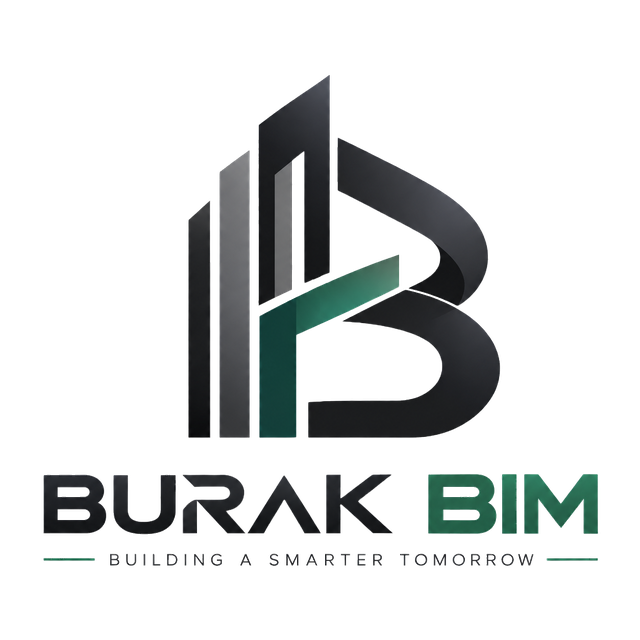

<p align="center"></p>

<h1 align="center">BURAK BIM</h1>
<p align="center"><b>One MCP connector for the whole Autodesk AEC stack.</b><br>
Revit · AutoCAD · Civil 3D · Plant 3D · Map 3D · Advance Steel · Navisworks · Inventor · ReCap Pro · Robot<br>
Versions 2022 – 2027 · Claude · ChatGPT Codex · Google Antigravity · Cursor · Gemini · VS Code · any MCP client</p>

---

Most MCP connectors for Autodesk software ship as **one server per product**, each with a **fixed list of hand-written tools**. If a command isn't in the list, the AI can't run it.

BURAK BIM takes a different approach. A single installer and a single MCP server detect every Autodesk product on the PC (plus Rhino/Grasshopper, Archicad and Dynamo), ship **about 1,000 tools** (332 for Revit, 113 for Navisworks, 49 for AutoCAD and its verticals, 406 for Archicad), and give the AI agent **six layers of control**. Each layer reaches further than the one before it:

| # | Layer | Reach | Products |
|---|---|---|---|
| 1 | **Purpose-built tools** (`revit_create`, `navisworks_clash_run`, `scan_to_bim`, `robot_calculate`, `archicad_properties`, …) | Fast, safe, documented | Revit, AutoCAD/Civil 3D, Navisworks, Inventor, Robot, Rhino + Grasshopper, Archicad, Dynamo |
| 2 | **Every ribbon button** (`ribbon_list`, `ribbon_invoke`) | Every tab, panel, split button and slide-out, including Architecture, Structure, Steel, Precast, Systems, Insert, Annotate, **Analyze**, Massing & Site, Collaborate, View, **Manage**, **Add-Ins**, Modify, contextual tabs and **third-party add-in tabs** | Revit, AutoCAD + verticals, Navisworks |
| 3 | **Every native command** (`revit_command`, `autocad_command`, `inventor_command`) | All Revit PostableCommands and internal command ids, all AutoCAD/Civil 3D command-line input and macros, all Inventor ControlDefinitions (~4,000) | Revit, AutoCAD family, Inventor |
| 4 | **The whole .NET API by reflection** (`api_inspect`, `api_get`, `api_call`, `api_set`) | Any class, property, method or constructor, discoverable at runtime | Revit, AutoCAD, Civil 3D, Navisworks |
| 5 | **Live C# scripting** (`script_run`) | Anything the API can do, in one undo step | Revit, AutoCAD, Civil 3D, Navisworks |
| 6 | **COM + Windows UI Automation** (`com_*`, `ui_*`, `screenshot`) | Any COM object, any dialog or window, and a screenshot to check the result | Inventor, AutoCAD + Civil 3D, Robot, Rhino, ReCap Pro, anything with a window |

On top of these layers come **Scan-to-BIM** and a **BIM-Inspector workflow**. Every element an AI creates is stamped (which AI client, session, tool, user and time), color-coded for review, checked against the point cloud, and logged in an audit trail.

## Contents
- [Install](#install)
- [What gets detected and connected](#what-gets-detected-and-connected)
- [Use it](#use-it)
- [Scan-to-BIM](#scan-to-bim)
- [BIM Inspector workflow](#bim-inspector-workflow)
- [Safety and governance](#safety-and-governance)
- [Tools](#tools)
- [Configuration](#configuration)
- [Folder layout](#folder-layout)
- [Uninstall](#uninstall)
- [Build from source](#build-from-source)
- [FAQ and honest limits](#faq-and-honest-limits)

## Install

**Requirements:**

- Windows 10/11 x64.
- Any of the supported Autodesk products installed.
- Internet access once during setup, to download the .NET 8 build tools into the install folder.
- No admin rights needed.

1. Download `BURAK-BIM-<version>.zip` from Releases and extract it.
2. **Close Revit, AutoCAD and Navisworks.**
3. Run **`BURAK-BIM-Setup-<version>.exe`**. Keep the default folder `D:\BURAK BIM` or pick another drive.
4. Restart your AI client. Fully quit Claude Desktop from the tray first.
5. Open Revit, AutoCAD or Navisworks and ask your AI: *"Use BURAK BIM: burak_status"*.

Without the .exe, you can run the PowerShell installer directly:

```powershell
powershell -ExecutionPolicy Bypass -File installer\install.ps1                      # D:\BURAK BIM, all detected AI clients
powershell -ExecutionPolicy Bypass -File installer\install.ps1 -InstallDir "E:\BURAK BIM" -Clients claude-desktop,codex
powershell -ExecutionPolicy Bypass -File installer\install.ps1 -WhatIf              # preview only
```

### What the installer does
1. **Detects** every Autodesk product wherever it is installed - `C:`, `D:` or a custom folder such as `D:\ALL PROGRAMS\NAVISWORK\...`. It reads the product version from each program file and looks in the standard folders on every drive, the Windows uninstall list, App Paths, the Autodesk registry keys, Start-menu shortcuts and running programs. For unusual locations add `-SearchPaths "D:\ALL PROGRAMS"` (remembered for later rescans), or ask the AI to run `burak_rescan` with `searchPaths`.
2. Installs a **private .NET 8 SDK** in `<install>\tools\dotnet`, but only if no SDK is already present. All caches go under `<install>\cache`, so nothing large lands on `C:`.
3. **Builds the BURAK BIM server**, a single self-contained `BurakBim.Server.exe`.
4. **Builds one bridge per detected version**, against that version's own API files. Autodesk DLLs are never redistributed.
5. **Registers the bridges:**
   - Revit: `.addin` manifest pointing to `D:\BURAK BIM\bridges\revit\<year>`.
   - AutoCAD family and Navisworks: Autodesk autoloader bundles. These are a trusted location, so there is no SECURELOAD prompt.
6. **Connects AI clients** it finds, keeping a `.bak` of every config file: Claude Desktop (classic and Store), Claude Code, Codex, Cursor, Windsurf, Google Antigravity, Gemini CLI and VS Code.
7. Installs the **BURAK BIM Sentinel**, a logon task that detects Autodesk versions installed later and connects them automatically. You can also run this check on demand with the `burak_rescan` tool.

## What gets detected and connected

| Product | Versions | How BURAK BIM controls it |
|---|---|---|
| Revit (Architecture, Structure, MEP, all disciplines) | 2022–2027 | In-process bridge add-in, plus a **BURAK BIM** ribbon tab |
| AutoCAD, Civil 3D, Plant 3D, Map 3D, AutoCAD Architecture, MEP, Electrical, Mechanical, Advance Steel | 2022–2027 (COM tools: any version) | In-process bridge (one plugin for every vertical) plus 38 ActiveX/COM tools: drawings, selection, drawing and editing, solids, dimensions, hatches, tables, blocks and attributes, xrefs, text, layers and standards, layouts, batch PDF plotting, export, drawing properties, quantities, Civil 3D surfaces / alignments / COGO points |
| Navisworks Manage and Simulate | 2022–2027 | In-process plug-in |
| Inventor | any with COM | COM: 20 `inventor_*` tools (documents, parameters, iProperties, iLogic, BOM, components, interference, features, constraints, materials, model states, drawings, images) |
| Robot Structural Analysis | any (RobotOM) | COM: 15 `robot_*` tools (model, supports, releases, loads, combinations, calculate, results, envelopes, reaction sums) |
| Rhinoceros 7 / 8 + Grasshopper | 7, 8 | COM: 13 `rhino_*` / `grasshopper_*` tools (commands, RhinoScript, geometry, layers, objects, user text, measurements, blocks, files, view capture, GH inputs/solve/bake) |
| Graphisoft Archicad | 24 and newer | **406 tools: one per command** of the official Archicad JSON API (80 commands, AC24-AC30) and the [Tapir add-on](https://github.com/ENZYME-APD/tapir-archicad-automation) (314 commands: create/modify every element type, MEP, design options, issues/BCF, revisions, keynotes, layouts, favorites, IFC, teamwork), each with its official JSON schema, plus 12 helper tools. Install the free Tapir add-on for the Tapir commands. |
| Dynamo | Revit's Dynamo, Dynamo Sandbox / Core | `revit_dynamo_run`, `dynamo_inspect`, `dynamo_set_inputs`, `dynamo_cli` |
| ReCap Pro | any | Launch plus UI automation. Point clouds are processed in Revit, Navisworks or AutoCAD |
| Other Autodesk desktop apps | any | Listed. UI automation and screenshots |

## Use it

Ask in plain language. These examples work in Claude, Codex, Antigravity and the others:

- *"In Revit, list everything on the Analyze tab and run Energy Settings."*
- *"Create a 6 x 4 m room of 200 mm walls on Level 1, a floor inside, and a door in the south wall."*
- *"Run clash detection in Navisworks between Structure and Ducts with 25 mm tolerance and summarize the new clashes."*
- *"In Civil 3D list all alignments with their lengths."*
- *"In Inventor set d0 to 75 mm, rebuild, and export a STEP file."*
- *"Link D:\Scans\Block-A.rcp, detect the levels and walls, show me the plan, then model it."*
- *"Show me the AI review view and write an inspection report."*

## Scan-to-BIM

ReCap `.rcp`/`.rcs` scans linked in Revit go through these steps:

```
scan_link_pointcloud → scan_detect_levels → scan_to_bim (dryRun) → review SVG plan → scan_to_bim (create)
                     → scan_deviation → inspector_review_view → inspector_mark → burak_inspection_report
```

- **Levels.** Floor tops and slab undersides are found from the scan's Z histogram, then compared with the Revit levels already in the model.
- **Walls.** A horizontal slice is taken, faces are found with RANSAC and least-squares fitting, and parallel faces are paired into walls with a centreline and measured thickness. Walls are snapped to the dominant orthogonal grid and their corners and T-joins are cleaned. Walls scanned from only one side are flagged.
- **Columns.** Rectangular and round columns are found from compact clusters, with size and a circle fit.
- **Slabs.** An outline is proposed (convex, and needs review).
- **Creation.** Every storey is created as one undo step, and every element is stamped *AI / unverified*.
- **QA.** For each element, BURAK BIM reports the mean, median, p95 and max distance of nearby scan points to its faces, with a pass/fail against your tolerance. The result is stored on the element.
- **Determinism.** The same scan always gives the same model, because the RNG seed is fixed. Inspectors can reproduce every result.

> **About LOD 500.** No software reaches LOD 500 automatically, because LOD 500 means *field-verified as-built*. BURAK BIM produces LOD 300–350 geometry measured against the scan. An element may be reported as **LOD 500** only after an inspector has **verified** it (`inspector_mark status=verified lod=500`) and it is within the scan tolerance. The inspection report counts these separately.

## BIM Inspector workflow

- Every element created through BURAK BIM carries an invisible **provenance stamp**, stored in Revit Extensible Storage (XData in AutoCAD). The stamp records the AI client, session, tool, Windows user, time and review status.
- **Revit ribbon:** BURAK BIM tab › BIM Inspector › **AI Review View** (red = unverified, green = verified, orange = rejected, purple = out of scan tolerance), **Verify Selected**, **Reject Selected**.
- `inspector_list`, `inspector_mark` and `inspector_review_view` provide the same functions to AI agents.
- `burak_inspection_report` writes an **HTML report** to `<install>\reports`, covering every AI element with its status, provenance, scan deviation and the day's audit trail.
- `burak_audit_log` covers **every** AI action: time, user, client, tool, arguments, result and duration. The trail lives in `<install>\audit\YYYY-MM-DD.jsonl` and is kept on uninstall.

## Safety and governance

- **One undo step per AI action.** Revit changes use transaction groups. Warnings are dismissed automatically and returned to the AI, and errors roll back.
- **Read-only mode.** Set `"readOnly": true` in `config\burakbim.json` to allow reads only. An AI agent cannot switch this off itself.
- **Switches.** `allowScripts`, `allowComAutomation` and `allowUiAutomation` turn individual layers on or off.
- **Local only.** Bridges listen on `127.0.0.1` with a random port and a per-session token, so nothing is exposed to the network.
- **Never runs late.** A request that times out while the app is busy (a dialog is open, a command is running) is **cancelled**, so it never runs late against the model.

## Tools

Out of the box there are **about 1,000 tools**. With `"toolsets": ["auto"]`, the AI only sees tools for software that is installed. The full, generated list with descriptions is in [docs/TOOLS.md](docs/TOOLS.md).

| Toolset | Count | Covers |
|---|---|---|
| archicad | 406 | Every Archicad JSON API command (elements, properties, classifications, attributes, navigator, layouts, publisher sets) and every Tapir command (create / modify walls, slabs, columns, beams, roofs, stairs, doors, windows, zones, morphs, meshes, curtain walls, dimensions, labels, texts; MEP routing and electrical; design options; issues and BCF; revisions; keynotes; favorites; libraries; IFC; teamwork) |
| revit | 332 | Modelling (walls, floors, roofs, ceilings, openings, groups, arrays, joins, parts, placement at points), structure (columns at grids, framing, foundations, rebar, loads, steel tonnage), MEP (duct / pipe / conduit / cable-tray routing, sizing, connectors, systems, spaces, circuits, insulation, slopes), views (plans, sections, elevations, 3D, dependent views, crop, range, templates, filters, phases, scope boxes), documentation (sheets, viewports, revisions, title blocks, tags, dimensions, text, legends, schedules), manage (parameters, shared / global parameters, families, materials, worksets, worksharing, links, copy from links, design options, purge, warnings, model health), QA (clearances, duplicates, untagged, naming, fire ratings, room finishes, in-place families, fake dimensions, templates, element history), export (PDF, DWG, IFC, NWC, images, CSV, JSON, all schedules, Dynamo) |
| navisworks | 113 | Federation (append folders, merge, compare model revisions, move models), selection and search (property, class, GUID, box, proximity), sets (incl. per-level search sets), properties, appearance profiles, visibility by property, viewpoints and issue views, plan cuts and section boxes, images, clash (create, run, matrix, grouping, triage, auto-approve, rename by level/grid, select clashing items, assignment, CSV/HTML reports), TimeLiner (CSV import/export, linking, 4D summary), comments, QA (missing data, duplicates, alignment, model health), grids and levels, exporters and add-in plug-ins |
| autocad | 49 | AutoCAD and every vertical (Civil 3D, Plant 3D, Map 3D, Advance Steel...): any command and LISP, plus the COM tools listed above |
| inventor / robot / rhino / dynamo | 20 / 15 / 13 / 3 | See the table above |
| api / com / recap | 8 / 5 / 2 | Ribbon, reflection and C# scripting; any COM object, members and type-library constants; ReCap |
| scan / inspector / core / ui | 7 / 3 / 9 / 7 | Scan-to-BIM, BIM-inspector workflow, status / launch / rescan / audit / tool search, screenshots and UI automation |

### Finding tools: full list or compact list

About 1,000 tool definitions would fill a large part of an AI's context window, so BURAK BIM adapts:

- **Claude Code** gets the full list (it loads MCP tools on demand).
- Other clients get the full list while it is small. With many products installed they get a **compact list**: every hand-written tool plus `burak_tools` (search all tools by keywords, with their input schemas) and `burak_run` (run any tool by name). Pack and catalog tools stay fully usable; the AI simply finds them by search.
- Force a mode in `config\burakbim.json` with `"exposure": "full"` or `"compact"` (takes effect when the AI client restarts).

### Tool packs - add your own tools without recompiling

Most Revit and Navisworks tools are **tool packs**: short C# snippets in `*.pack` files that run inside the host through `script_run`, in one undo step. The built-in packs are embedded in the server; drop your own `*.pack` files into `<install>\toolpacks\` and restart the AI client to add company-specific tools. Format:

```
@@ revit_my_tool
title: My tool
host: revit            (revit | navisworks | autocad)
tx: true               (run in a transaction)
desc: What it does.
arg: ids | ids | Elements (omit = selection)
arg: heightMm | number! | Required number
code:
foreach (var e in Elems("ids")) SetPrm(e, "Comments", "checked");
return R("ok", true);
```

Pack tools need the full (Roslyn) bridge, which the installer builds on your PC. All 307 Revit pack tools are compile-checked against the Revit 2024 API. The Navisworks pack tools have only been syntax-checked so far, because the Navisworks API files were not available when this release was built. Each pack tool is compiled when it is first used, so an API difference in one Navisworks version affects only that one tool, and the compiler error goes back to the AI.

The server also provides MCP **prompts**: `scan_to_bim`, `clash_coordination`, `inspection_review` and `model_audit`.

## Configuration

Settings live in `<install>\config\burakbim.json`. The file is re-read on every call, so changes need no restart.

```json
{
  "readOnly": false,
  "allowScripts": true,
  "allowComAutomation": true,
  "allowUiAutomation": true,
  "toolsets": ["auto"],
  "requestTimeoutSeconds": 180,
  "maxPointsPerRequest": 400000,
  "inspectorName": "",
  "extraSearchPaths": ["D:\\ALL PROGRAMS"],
  "exposure": "auto",
  "company": "BURAK BIM"
}
```

### Manual client setup

Use this for any MCP client the installer doesn't know (stdio transport):

```json
{ "mcpServers": { "BURAK-BIM": { "command": "D:\\BURAK BIM\\server\\BurakBim.Server.exe", "args": [] } } }
```

The server identifies itself as **BURAK BIM**. The config key is `BURAK-BIM`, because some clients reject spaces in server names. Per-client details are in [docs/CLIENTS.md](docs/CLIENTS.md).

## Folder layout

```
D:\BURAK BIM\
  server\BurakBim.Server.exe        MCP server (single file)
  bridges\revit|autocad|navisworks\<year>\   bridges built for your versions
  config\burakbim.json              settings          audit\      AI action trail (kept on uninstall)
  reports\                          inspection reports, scan previews (kept)
  exports\  captures\  logs\  runtime\  scratch\
  tools\dotnet\  cache\             private build tools (never on C:)
  setup\                            source, installer, uninstaller, docs
```

The only files on `C:` are small manifests that Autodesk products require in their own locations:

- `%APPDATA%\Autodesk\Revit\Addins\<year>\BurakBim.addin`
- `%APPDATA%\Autodesk\ApplicationPlugins\BurakBim.*.bundle`, about 200 KB each
- The AI client config entries

## Uninstall

Use Windows **Apps & Features › BURAK BIM**, or run:

```powershell
powershell -ExecutionPolicy Bypass -File "D:\BURAK BIM\setup\uninstall.ps1"          # keeps audit, reports, config, logs
powershell -ExecutionPolicy Bypass -File "D:\BURAK BIM\setup\uninstall.ps1" -Purge   # removes everything
```

## Build from source

```powershell
# server (any machine with the .NET 8 SDK)
dotnet publish src\BurakBim.Server -c Release -r win-x64 --self-contained -p:PublishSingleFile=true -o out\server
# bridges (need the matching Autodesk product installed)
dotnet build src\BurakBim.Bridge.Revit -c Release -p:RevitYear=2024 -p:RevitDir="C:\Program Files\Autodesk\Revit 2024"
dotnet build src\BurakBim.Bridge.AutoCAD -c Release -p:AcadYear=2024 -p:AcadDir="C:\Program Files\Autodesk\AutoCAD 2024"
dotnet build src\BurakBim.Bridge.Navisworks -c Release -p:NavisYear=2024 -p:NavisDir="C:\Program Files\Autodesk\Navisworks Manage 2024"
# release ZIP + Setup.exe
pwsh build\build-release.ps1
# algorithm self-test (synthetic scan)
out\server\BurakBim.Server.exe --selftest
```

The architecture is described in [docs/ARCHITECTURE.md](docs/ARCHITECTURE.md). Before a release, run through the test checklist in [docs/TESTING.md](docs/TESTING.md).

## FAQ and honest limits

- **Can it press every button?** Every AdWindows ribbon item in Revit, AutoCAD and its verticals, and Navisworks can be listed and invoked. Commands that wait for **picks or dialog input** start normally; the AI then continues with `ui_*` tools and checks its work with `screenshot`, or the user finishes the step. Revit runs posted commands one at a time.
- **ReCap Pro** has no public automation API. BURAK BIM launches it and drives it through UI automation. Point-cloud processing happens in Revit, Navisworks or AutoCAD, which load ReCap `.rcp`/`.rcs` files natively.
- **Scan-to-BIM** handles walls, columns, levels and slab outlines. MEP runs, doors and windows, and sloped or curved elements still need modelling with the other tools, plus inspector review.
- **Testing status.** v1.0.0 compiles against the real Revit 2024 API. The AutoCAD and Navisworks bridges are compiled on your machine against your installed versions. See [docs/TESTING.md](docs/TESTING.md) for the test status of each version.

---
BURAK BIM is an independent product, not affiliated with Autodesk, Inc. Autodesk product names are trademarks of Autodesk, Inc. Licensed under the [Apache License 2.0](LICENSE).
